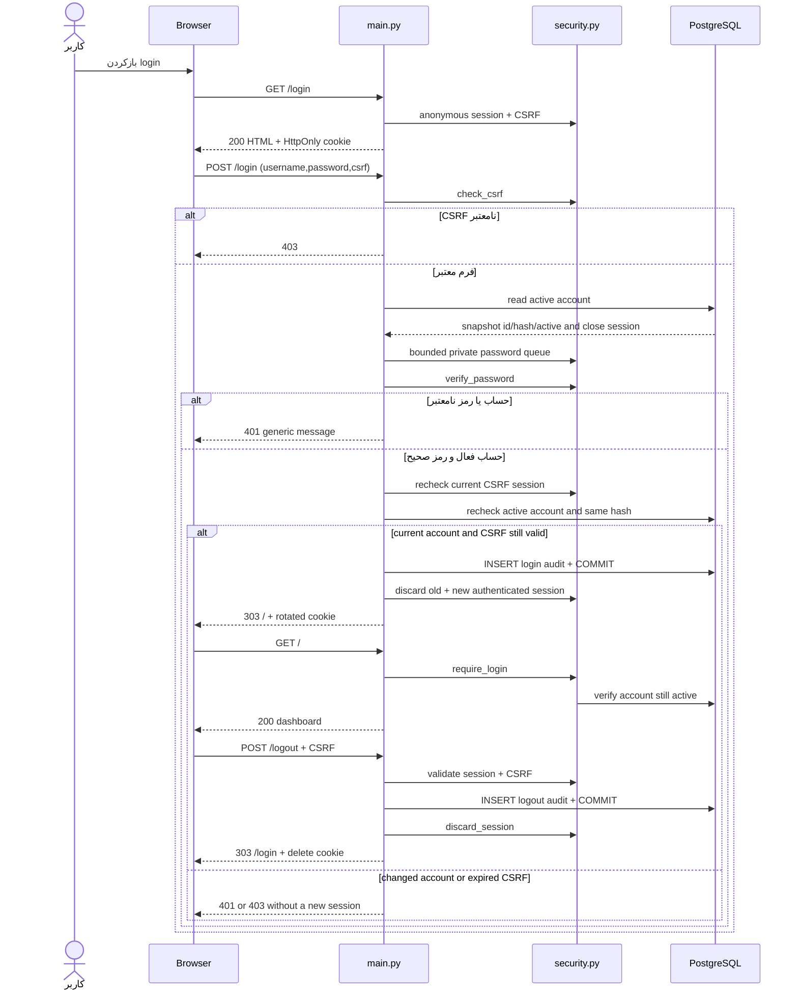
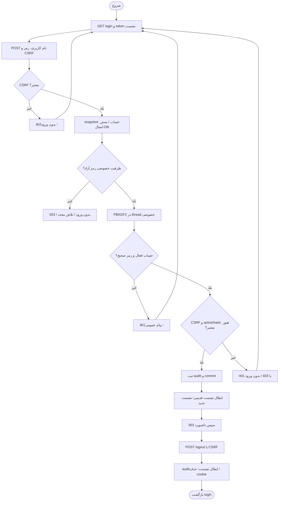
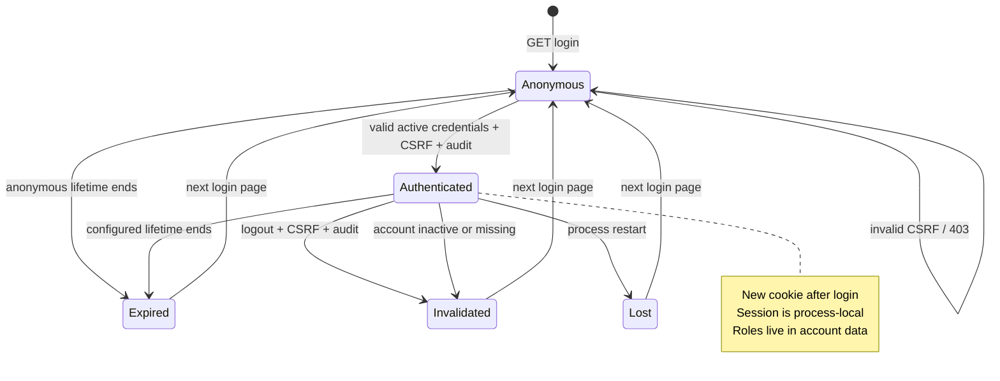

# UC-01-models — مدل‌های قابل مشاهدهٔ HRMS

از رفتار فعلی بازسازی شده؛ تأیید انسانی ثبت نشده است. نسخهٔ editable و شناسه‌ها در [فهرست مدل‌ها](README.md).

## SEQ-01 — Authenticate and logout sequence

## ACT-01 — Authentication activity

## ST-01 — Session lifecycle

