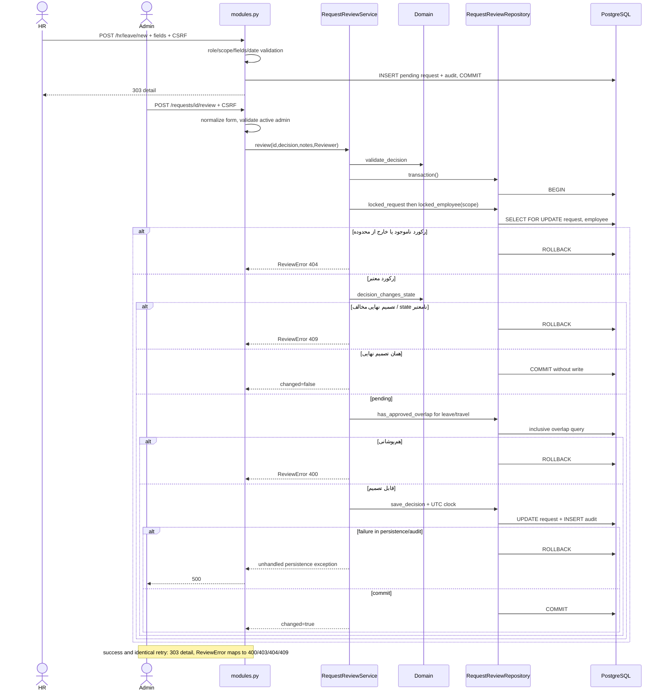
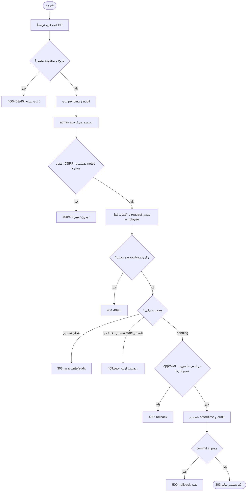

# UC-02-models — مدل‌های قابل مشاهدهٔ HRMS

از رفتار فعلی بازسازی شده؛ تأیید انسانی ثبت نشده است. نسخهٔ editable و شناسه‌ها در [فهرست مدل‌ها](README.md).

## SEQ-02 — Request creation and decision sequence

## ACT-02 — HR request activity

## ST-02 — Request decision lifecycle

```mermaid
%% ST-02 — Request decision lifecycle
stateDiagram-v2
    [*] --> Pending: valid creation + audit
    Pending --> Pending: valid edit
    Pending --> Approved: admin approval; no approved overlap; atomic audit
    Pending --> Rejected: admin rejection; nonblank reason; atomic audit
    Pending --> Pending: invalid input / overlap / audit failure
    Approved --> Approved: identical retry; no new write/audit
    Rejected --> Rejected: identical retry; no new write/audit
    note right of Approved
      Opposite final decision returns 409
      Editing finalized request is rejected
    end note
    note right of Rejected
      Opposite final decision returns 409
      No cancelled state is implemented
    end note
```

