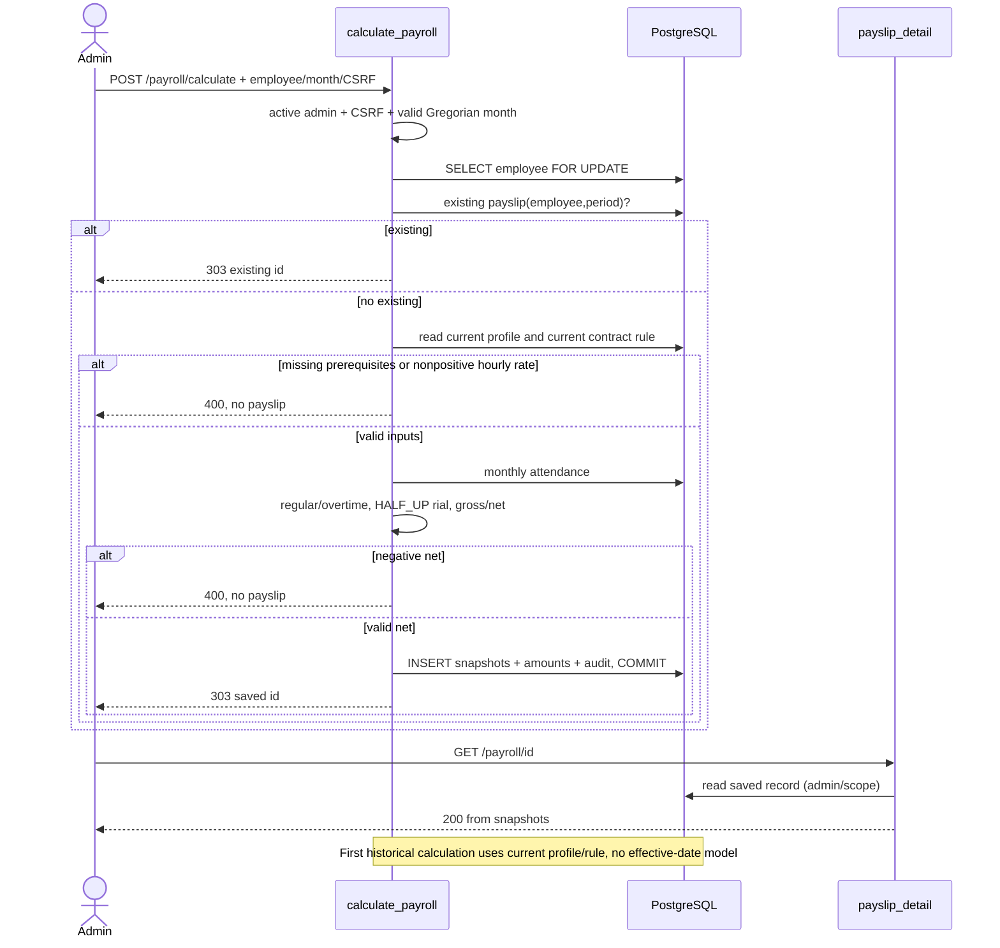
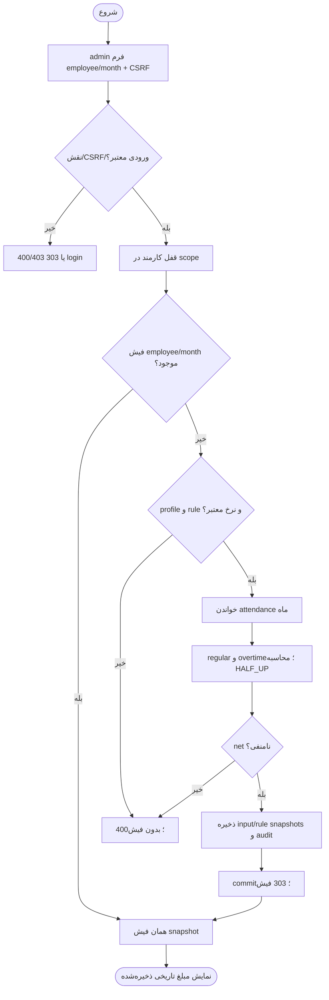

# UC-03-models — مدل‌های قابل مشاهدهٔ HRMS

از رفتار فعلی بازسازی شده؛ تأیید انسانی ثبت نشده است. نسخهٔ editable و شناسه‌ها در [فهرست مدل‌ها](README.md).

## SEQ-03 — Payroll calculation and saved retry

## ACT-03 — Payroll activity

## ST-03 — Payslip persistence lifecycle

```mermaid
%% ST-03 — Payslip persistence lifecycle
stateDiagram-v2
    [*] --> NoPayslip
    NoPayslip --> NoPayslip: invalid input / missing profile or rule / negative net
    NoPayslip --> Saved: valid calculation; snapshots + audit commit
    Saved --> Saved: same employee/month retry
    Saved --> Saved: display from saved snapshots
    note right of Saved
      These are conceptual persistence states
      Payslip has no status column
      No update/recalculate route exists
      Direct SQL UPDATE is not prevented
    end note
```

