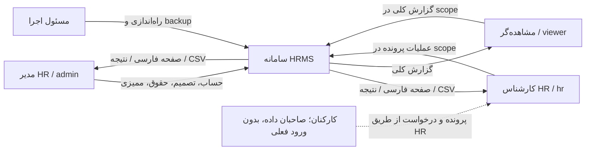
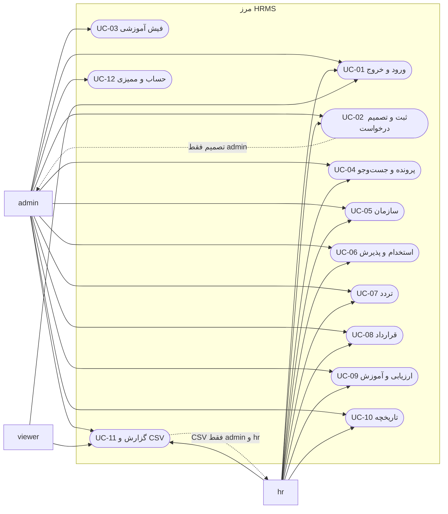
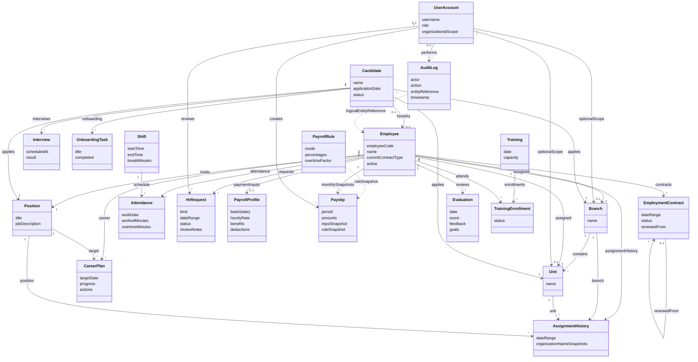

# analysis-models — مدل‌های قابل مشاهدهٔ HRMS

از رفتار فعلی بازسازی شده؛ تأیید انسانی ثبت نشده است. نسخهٔ editable و شناسه‌ها در [فهرست مدل‌ها](README.md).

## CTX-01 — HRMS context

## UCM-01 — Use-case model

## DM-01 — Conceptual domain

