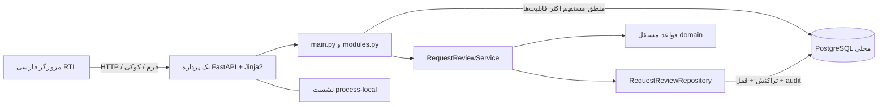

# ARCH-01 — معماری موجود و انتخاب مسیر تکامل

نسخهٔ ۱، 2026-11-08. وضعیت: توصیف اجرا و تصمیم اجرایی عامل؛ بازبینی دانشجو ثبت نشده است.

برنامه یک مونولیت با یک PostgreSQL و رندر سمت سرور است. SQLAlchemy رابط داده است. فقط گردش تصمیم درخواست، Domain / Service / Repository دارد. گروه‌بندی هشت حوزهٔ HR یا تعداد فایل‌ها، مرز ماژول معماری در کل برنامه ایجاد نمی‌کند.

## سه گزینه و تصمیم

| معیار | A — مونولیت ساده | B — مونولیت با مرزهای داخلی | C — Microservices |
|---|---|---|---|
| خوانایی مبنای مبتدی | مسیر مستقیم و ساده | فایل و قرارداد بیشتر | نیاز به شبکه و چند استقرار |
| آزمون مستقل قواعد | وابستگی به HTTP/DB | قواعد مستقل از framework | قرارداد و integration شبکه‌ای |
| تراکنش درخواست و audit | یک پایگاه | همان تراکنش واحد | نیاز به طراحی پیام/سازگاری |
| استقرار و رفع اشکال | کم‌هزینه | کم‌هزینه با انضباط مرزها | پایش و عملیات پیچیده‌تر |
| مقیاس مستقل | محدود | هنوز استقرار مشترک | بالقوه، اثبات‌نشده برای این پروژه |
| وضعیت HRMS | مبنای بیشتر کد | برای تصمیم درخواست اعمال شده | اعمال نشده |

انتخاب فعلی ترکیب A با گام محدود B است. علت گام B، تعارض پاسخ تصمیم نهایی و دشواری آزمون قواعد بود؛ افزایش توان عملیاتی هدف آن نیست. [ADR-01](ADRs/ADR-01-baseline.md) انتخاب مبنا و [ADR-04](ADRs/ADR-04-request-workflow.md) اصلاح را توضیح می‌دهند.

## مرزهای اعتماد و کیفیت

مرورگر ورودی نامطمئن می‌فرستد؛ نشست، CSRF، نقش و محدوده در وب کنترل می‌شوند. Repository بازبینی دامنه و قفل‌های پایگاه را اجرا می‌کند. رخداد audit همراه تغییر عملیاتی commit می‌شود. این audit امضاشده یا مقاوم در برابر مدیر پایگاه نیست.

کیفیت فعلی: تراکنش/قفل و uniqueness در PostgreSQL، RBAC همراه scope، کوکی HttpOnly، CSP و snapshot فیش. محدودیت‌ها: نشست حافظه‌ای، بدون HA/cache/queue، گزارش همگام، فهرست بدون صفحه‌بندی، مهاجرت نسخه‌دار و پایش جامع ساخته نشده‌اند.

[سناریوهای کیفیت](quality-scenarios.md)، [طراحی](../06-design/design.md)، [نقشهٔ آزمایش‌ها](progressive-experiments.md) و [اثر تغییر CR-01](../10-final-report/changes/CR-01.md) قراردادهای این معماری را تکمیل می‌کنند.
