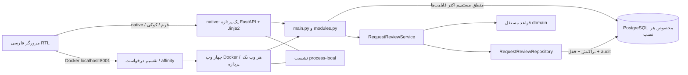

# ARCH-01 — معماری موجود و انتخاب مسیر تکامل

نسخهٔ ۲، 2026-11-17؛ استخراج دوباره از کد و تنظیمات موجود. بازبینی انسانی ثبت نشده است. [گزارش بررسی، ظرفیت و اولویت‌ها](current-architecture-review-20261117.md) مرجع این نوبت است؛ نسخهٔ پیشین در snapshot حفظ شده است.

برنامه یک مونولیت با PostgreSQL و رندر سمت سرور است. SQLAlchemy رابط داده است. فقط گردش تصمیم درخواست، Domain / Service / Repository دارد. گروه‌بندی هشت حوزهٔ HR یا تعداد فایل‌ها، مرز ماژول معماری در کل برنامه ایجاد نمی‌کند. راه‌انداز native یک وب دارد؛ Docker پس از [شاهد ورود هم‌زمان](experiments/EXP-LOGIN-PROXY-20261117.md) به چهار وب و proxy با affinity ارتقا یافت. [استقرار واقعی](../08-testing/evidence/login500-live-deployment-20261117-a.json) شش سرویس healthy و حفظ همان volume را با sentinel ساختگی ثبت می‌کند. نشست هر وب در حافظهٔ خودش است؛ این topology روی یک میزبان است و HA نیست.

## سه گزینه و تصمیم

| معیار | A — مونولیت ساده | B — مونولیت با مرزهای داخلی | C — Microservices |
|---|---|---|---|
| خوانایی مبنای مبتدی | مسیر مستقیم و ساده | فایل و قرارداد بیشتر | نیاز به شبکه و چند استقرار |
| آزمون مستقل قواعد | وابستگی به HTTP/DB | قواعد مستقل از framework | قرارداد و integration شبکه‌ای |
| تراکنش درخواست و audit | یک پایگاه | همان تراکنش واحد | نیاز به طراحی پیام/سازگاری |
| استقرار و رفع اشکال | کم‌هزینه | کم‌هزینه با انضباط مرزها | پایش و عملیات پیچیده‌تر |
| مقیاس مستقل | محدود | هنوز استقرار مشترک | بالقوه، اثبات‌نشده برای این پروژه |
| وضعیت HRMS | مبنای بیشتر کد | برای تصمیم درخواست اعمال شده | اعمال نشده |

انتخاب فعلی ترکیب A با گام محدود B است. علت گام B، تعارض پاسخ تصمیم نهایی و دشواری آزمون قواعد بود؛ افزایش توان عملیاتی هدف آن نیست. [ADR-01](ADRs/ADR-01-baseline.md) انتخاب مبنا و [ADR-04](ADRs/ADR-04-request-workflow.md) اصلاح را توضیح می‌دهند.

## مرزهای اعتماد و کیفیت

مرورگر ورودی نامطمئن می‌فرستد؛ نشست، CSRF، نقش و محدوده در وب کنترل می‌شوند. Repository بازبینی دامنه و قفل‌های پایگاه را اجرا می‌کند. رخداد audit همراه تغییر عملیاتی commit می‌شود. این audit امضاشده یا مقاوم در برابر مدیر پایگاه نیست.

کیفیت فعلی: تراکنش/قفل و uniqueness در PostgreSQL، RBAC همراه scope، کوکی HttpOnly، CSP و snapshot فیش. فهرست کارکنان، ماژول‌ها و فیش‌ها صفحه‌بندی دارند؛ نام منابع فهرست ماژول از همان صفحه به‌صورت دسته‌ای خوانده می‌شود. CSV فقط ستون‌های خروجی را با batch پایگاه می‌خواند ولی پاسخ کامل buffered است. محدودیت‌ها: نشست حافظه‌ای، بدون HA/cache بین درخواست‌ها/queue، گزارش همگام، گزینه‌های کامل فرم‌های GET، مهاجرت نسخه‌دار و پایش جامع. جزئیات هزینه و شرط رفع در گزارش جاری است.

[سناریوهای کیفیت](quality-scenarios.md)، [طراحی](../06-design/design.md)، [نقشهٔ آزمایش‌ها](progressive-experiments.md) و [اثر تغییر CR-01](../10-final-report/changes/CR-01.md) قراردادهای این معماری را تکمیل می‌کنند.

## نمای اجرای جاری و پیامد خرابی

| پروفایل | تقسیم درخواست و نشست | پیامد خرابی قابل مشاهده |
|---|---|---|
| native یا baseline تک‌وب | یک فرایند و نشست حافظه‌ای | توقف وب دسترسی را موقتاً قطع می‌کند و نشست پس از راه‌اندازی از دست می‌رود. |
| Docker پیش‌فرض | چهار فرایند وب و affinity؛ نشست در همان وب | توقف یک وب می‌تواند نشست‌های همان وب را از دسترس خارج کند. پراکسی و PostgreSQL نقاط مشترک همهٔ فرایندها هستند. |
| Docker با Redis | توزیع میان وب‌ها و نشست مشترک | restart یک وب با Redis و token معتبر نشست را حفظ می‌کند. نبود Redis در مسیر نیازمند نشست پاسخ 503 دارد. |

[دستور اجرا و پیکربندی‌ها](../../deployments/README.md) · [شواهد آزمایش نشست مشترک](experiments/EXP-SHARED-SESSIONS-20261117.md)
