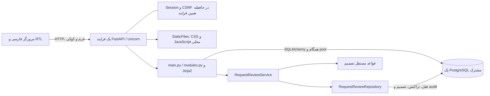

# بازبینی معماری HRMS — 2026-11-17

این محصول موجود با سه اصلاح محدود بهبود یافت: خواندن دسته‌ای نام منابع صفحه، حذف materialization اضافی ورودی CSV و یکسان‌کردن کلید ماه گزارش. schema، قرارداد خارجی، session و topology تغییر نکردند. شواهد این نوبت ظرفیت 500 کاربر، HA یا stateless بودن وب را تأیید نمی‌کنند.

منبع بررسی: کد همهٔ اجزای `app/`، مسیرها و فرم‌ها، مدل‌ها/قیود، تنظیمات و راه‌اندازهای native و Compose، migration/seed/backup، آزمون/CI، specs و مستندات جاری و نتایج آزمایش‌های قبلی. [inventory با hash منابع و شمارش فقط‌خواندنی](../08-testing/evidence/architecture-inventory-20261117-c.json) و [snapshot پیش از بررسی](../snapshots/architecture-review-baseline-20261117-b.json) حد بررسی را قابل پیگیری می‌کنند. وابستگی‌های vendor و آرشیوهای قدیمی source محصول جدید محسوب نشدند؛ شواهد تاریخی دوباره به‌عنوان آزمون امروز معرفی نمی‌شوند. `.env`، credential و سطر واقعی HR صادر نشده‌اند.

معماری/رفتار قبلی از کد بازسازی شد. برای سه تغییر تازه، FR/BR، UC، مدل، طراحی و ADR پیش از اصلاح کد ثبت و در [snapshot طرح](../snapshots/architecture-read-plan-20261117-a.json) حفظ شدند. بررسی انسانی، پذیرش استاد، مشارکت/یادگیری و سیاست واقعی HR در انتظارند.

## 1. نقشهٔ معماری فعلی و جریان درخواست

برنامه یک مونولیت رندر سمت سرور است. فقط workflow تصمیم درخواست مرز Domain/Service/Repository دارد؛ سایر قواعد عمدتاً در routeهای `main.py` و `modules.py` و config فرم‌اند. APIهای کاربردی HTML، فرم و 303 یا CSV هستند؛ `/health` و `/instance` JSON می‌دهند. Swagger/runtime OpenAPI خاموش و قراردادها به فایل [OpenAPI مرورگر](../06-design/openapi-browser.yaml) صادر می‌شوند. inventory فعلی 40 عملیات HTTP و مدل مشترک 21 جدول دارد. Employee صاحب پرونده است؛ حساب وب در `admins` با نقش admin/hr/viewer نگهداری می‌شود و هر کارمند حساب ورود ندارد.

| بخش | پیاده‌سازی و تنظیم واقعی | نتیجهٔ معماری |
|---|---|---|
| native | `scripts/start*.ps1` و `launch.ps1`، یک Uvicorn روی loopback:8000؛ PostgreSQL جدا روی loopback:55432 | وب و DB از قبل دو فرایندند؛ استقلال deployment کامل یا HA ندارند |
| Compose | `deployments/compose.yaml`، یک web و یک PostgreSQL 17.6، شبکه backend، volume داده و فایل secret runtime؛ وب روی loopback:8001 | جداسازی container و عمر volume انجام شده، هر دو روی یک میزبان؛ replica/failover نیست |
| اجرا و schema | `app/seed.py` و entrypoint از `create_all` استفاده می‌کنند؛ upgradeها اسکریپت‌های افزایشی دستی‌اند | `create_all` تغییر schema موجود را versioned migrate نمی‌کند؛ سازگاری app/schema قبل از تغییر بعدی لازم است |
| وب و اتصال | sync route/SQL، thread limiter پیش‌فرض 40؛ pool_size=5، max_overflow=10، pre_ping | پیش‌فرض سقف اتصال هر وب 15 است؛ افزایش thread/web باید با ظرفیت مشترک DB حساب شود |
| نشست | `security.sessions` و Lock؛ نشست authenticated پیش‌فرض 8 ساعت، anonymous 30 دقیقه؛ کوکی HttpOnly/SameSite=Lax | restart نشست را از بین می‌برد؛ وب stateless نیست؛ COOKIE_SECURE=false برای localhost تنظیم شده است |
| داده | FK مرکب واحد/شعبه، uniqueness تردد و فیش، partial unique قرارداد فعال و انتساب جاری، JSON snapshot و audit | تراکنش محلی مفید است؛ read replica یا sharding می‌تواند این سازگاری را پیچیده کند |
| آزمایش چند وب | `run_native_cluster.py` و `native_proxy.py`، چهار وب آزمایشی با affinity و schema disposable | مسیر آزمایش جداست؛ affinity مشکل restart یا از دست رفتن یک worker را حل نمی‌کند |
| عملیات | Uvicorn log و `/health` با SELECT 1؛ workflow آزمون GitHub آماده است | latency/metrics/alerts پیوسته و استقرار خودکارِ اجراشده نداریم؛ health به DB و همان pool وابسته است |

این نوبت PostgreSQL native برای آزمون روشن شد. probeهای وب 8000/8001 حتی در بررسی خارج از sandbox به timeout رسیدند؛ پاسخ healthy تازه برای آن وب‌ها ثبت نشد. Docker API نیز daemon قابل دسترس نداشت. این مشاهده وضعیت محیط این اجراست و علت آن به کد HR نسبت داده نشده است. [شاهد Docker روز 2026-11-16](experiments/EXP-DOCKER-COMPOSE.md) تاریخچهٔ اجرای سالم است. image rebuild، restart وب زنده یا مهاجرت DB در این نوبت انجام نشد؛ کد تازه با TestClient و PostgreSQL واقعی آزموده شد.

### جریان‌های دنبال‌شده

| عملیات واقعی | مسیر، قواعد و query/transaction |
|---|---|
| مشاهدهٔ پرونده | GET `/employees/{employee_id}` → `require_login` حساب فعال را یک بار می‌خواند → `scoped_employee` نقش hr/admin و branch/unit را روی query اعمال می‌کند → سه `db.get` برای نام سازمان → Jinja2؛ خارج scope=404، viewer=403، بدون نشست=303. این مسیر روی یک پرونده کار می‌کند و N+1 فهرست نیست |
| فهرست مرخصی/تردد | GET `/hr/{module}` → config نقش/ماژول → scope/filter → count و LIMIT/OFFSET، پیش‌فرض 50 و سقف 100 → پس از اصلاح، یک projection نام به ازای نوع مرجع همان صفحه → HTML و لینک‌های همان فیلتر |
| ثبت مرخصی | POST `/hr/leave/new` → browser_form، session و CSRF → گزینهٔ employee ارسالی در scope، parse و کنترل start<=end → `HrRequest(kind=leave,status=pending)` و audit در یک commit → 303. ثبت برای کارمند توسط HR/admin انجام می‌شود؛ self-service کارکنان پیاده نشده است |
| تأیید درخواست | POST `/requests/{id}/review` → admin/CSRF → Reviewer/Service → قفل request سپس employee → قواعد تصمیم نهایی و query هم‌پوشانی inclusive → update + audit در همان تراکنش. retry یکسان=303 بدون تغییر/audit جدید، تصمیم مخالف=409، overlap=400؛ failure audit باعث rollback است |
| گزارش ماه | GET `/reports?period=...` → حساب/نقش/محدوده → ماه میلادی normalizeشده → group/count کارمندان با سازمان فعلی، sum تردد، درخواست‌های intersecting و sum فیش فقط برای admin → HTML. گزارش سازمان تاریخی نیست؛ فیش قبلی از snapshot نگهداری می‌شود |
| خروجی CSV | GET `/reports/employees.csv` → hr/admin/scope → join کارمند و سازمان با projection هشت ستون و ترتیب id → batch 500 ردیفی و writer با formula protection → بستن cursor، audit تعداد واقعی و commit → پاسخ کامل UTF-8 BOM. GET این مسیر اثر جانبی audit دارد؛ cache/retry آینده باید آن را لحاظ کند |
| حقوق آموزشی | POST `/payroll/calculate` → admin/CSRF/ماه → قفل employee و جست‌وجوی فیش employee/month → profile/rule فعلی و تردد همان ماه → Decimal/ROUND_HALF_UP و snapshot + audit در commit. تکرار، فیش ذخیره‌شده را برمی‌گرداند؛ نرخ قانونی فرض نمی‌شود |

## 2. مشکلات تأییدشده و شواهد

«مشاهده‌شده» به کد یا آزمون قابل بازتولید اشاره دارد؛ «ریسک» اثر محتملِ یک تغییر بار/خرابی است؛ «فرض» نیاز به دادهٔ دیگری دارد.

| شناسه و طبقه | شاهد | اثر و وضعیت |
|---|---|---|
| O-01 — مشاهده‌شده، N+1 برچسب | نسخهٔ پیش از تغییر `modules.module_list` در snapshot، حلقهٔ `display_value` و `db.get`؛ آزمایش 50 ردیف: مرخصی 53، تردد 103 SELECT | رفت‌وبرگشت اضافی DB حتی پس از صفحه‌بندی؛ با ADR-11 به 4/5 اصلاح شد |
| O-02 — مشاهده‌شده، ورودی اضافی CSV | query قبلی `select(Employee,...).all()` کل ORM و ستون‌های غیرخروجی را می‌خواند؛ 10,000 ردیف ساختگی، peak allocation=28,714,758 bytes | لیست ORM/rows هم‌زمان با CSV در حافظه؛ ADR-12 آن را حذف کرد، ولی پاسخ نهایی هنوز کامل buffered است |
| O-03 — مشاهده‌شده، کلید ماه ناسازگار | `reports` برای validation/start/end normalize می‌کرد ولی `Payslip.period == period` ورودی اولیه را می‌گرفت؛ فیش ساختگی Jan 2025 برای ماه فارسی/عربی جمع 0 و لاتین 1,000,000 می‌داد | گزارش مالی آموزشی نادرست برای ورودی معتبر؛ ADR-13 هر سه را به همان کلید متصل کرد |
| O-04 — مشاهده‌شده، مدارک جاری ناسازگار | معماری قدیمی «فهرست بدون صفحه‌بندی» و فهرست UC «UC-04 بدون specification» می‌گفت، در حالی که `pagination.py` و UC-04 وجود داشتند | برداشت اشتباه از معماری؛ معرفی جاری، UC و traceability تصحیح شد؛ نسخهٔ قبلی در snapshot محفوظ است |
| O-05 — مشاهده‌شده، پایش محدود | app فقط health و لاگ عادی دارد؛ راه‌انداز Uvicorn/Compose و CI فاقد metrics/alerts و مرحلهٔ deploy اجراشده‌اند | RPS، latency، اشباع pool و availability واقعی قابل استنتاج نیست؛ instrumentation قدم بعدی است |
| R-01 — ریسک Scale Out/rolling restart | dict نشست در `security.py` و affinity آزمایشی در proxy | وب دوم بدون shared session می‌تواند نشست/CSRF را نشناسد؛ خرابی/restart یک وب نشست خودش را حذف می‌کند. در topology تک‌وب فعلی به‌عنوان رخداد خرابی مشاهده‌شده گزارش نمی‌شود |
| R-02 — ریسک تک‌نقطهٔ شکست | یک وب، یک DB و یک میزبان/volume در launch و Compose؛ replication/failover تعریف نشده | خرابی هر کدام می‌تواند خدمت را قطع کند؛ restart policy یا volume، HA نیست و unhealthy شدن به‌تنهایی failover نمی‌سازد |
| R-03 — ریسک رشد GET فرم/CSV | `options_for` و `fields_for` برای GET و فرم خطا `.all()`؛ `/payroll` dropdown تمام کارکنان دارد. CSV خروجی کامل است | با catalog بزرگ render/حافظه/زمان رشد می‌کند؛ آزمایش اصلاح POST قبلی این GETها را حل نکرده است. انتخاب‌گر جست‌وجویی به طرح UI/API نیاز دارد |
| R-04 — ریسک queryهای دوره/هم‌پوشانی | `HrRequest` ایندکس employee/status/date ندارد؛ Attendance و Payslip unique با employee در ابتدای index دارند؛ query دورهٔ کل سازمان از تاریخ/period شروع می‌کند | در دادهٔ بزرگ‌تر ممکن است scan غالب شود. نبود ایندکس یا Seq Scan به‌تنهایی افت کارایی اثبات نمی‌کند؛ native اکنون هیچ request/attendance/payslip ندارد |
| R-05 — ریسک مهاجرت و بازیابی | `create_all`، upgradeهای دستی و backup script؛ آزمون timed restore/CI deploy ثبت نشده | app و schema ممکن است در ارتقا ناسازگار شوند؛ RPO/RTO پیشنهادی هنوز اندازه‌گیری نشده‌اند |
| R-06 — ریسک exposure عمومی/ورود | COOKIE_SECURE=false و HTTP loopback؛ 600,000 دور PBKDF2 برای login و نبود rate limiter | تنظیم مناسب localhost، آمادهٔ TLS عمومی نیست؛ فشار ورود جدا از بار کاربران واردشده باید اندازه‌گیری شود. لاگ عادی URL می‌تواند q جست‌وجو را داشته باشد؛ گزارش از لاگ HR زنده استخراج نشد |
| H-01 — فرض تأییدنشده | تعداد کاربران واقعی هم‌زمان، ساعات خدمت، SLA، بودجه و رشد داده دریافت نشده‌اند | 500 نشست آزمایش یا NFR آموزشی، عدد کاربران سازمان واقعی نیست |
| H-02 — فرض تأییدنشده | شاهد ترافیک چندمنطقه‌ای، گزارش چنددقیقه‌ای، فشار cacheable reads یا دادهٔ چندترابایتی نداریم | CDN/queue/cache/read replica/sharding برای محصول فعلی توجیه اجرایی ندارد |

شاهد قبل/بعد O-01..03 در [اندازه‌گیری قبل](../08-testing/evidence/architecture-reads-before-20261117-d.json)، [بعد](../08-testing/evidence/architecture-reads-after-20261117-a.json) و [مقایسهٔ ماشینی](../08-testing/evidence/architecture-read-comparison-20261117-a.json) است. در آزمایش مصنوعی، overlap با 10,000 درخواست pending کل جدول را scan و صفر ردیف پیدا کرد، Execution Time حدود 1.84ms بود؛ جمع Attendance/Payslip نیز همهٔ دادهٔ همان یک ماه را با حدود 1.91/2.95ms scan کرد. این توزیع غیرانتخابی برای تصمیم دربارهٔ ایندکس دوره مناسب نیست؛ ایندکس آزمایشی/زنده‌ای اعمال نشد.

## 3. ظرفیت: واقعیت، آزمایش و فرض

### دادهٔ فعلی و حدود شناخت

شمارش فقط‌خواندنی schema native/public: 21 جدول، 1 حساب فعال، 11 کارمند که 10 مورد seed marker دارند؛ منشأ مورد دیگر استنتاج نشده است. Attendance، HrRequest و Payslip صفر ردیف دارند. مجموع فضای relationهای این 21 جدول با indexes حدود 1,081,344 bytes، یعنی 1.03 MiB است؛ این اندازهٔ allocation فعلی است، نه حجم فایل export. شمار همهٔ جدول‌ها پیش/پس از آزمون ثابت ماند. PostgreSQL 17.6: max_connections=100، shared_buffers=128MB، work_mem=4MB. این اعداد [اندازه‌گیری](../08-testing/evidence/architecture-inventory-20261117-c.json) هستند؛ tuning پیشنهادی نیستند.

RPS/latency تولید و تعداد مرورگر فعال امروز نداریم. شواهد تاریخی قابل استفاده برای شناخت شکست‌اند: [load سبک](../08-testing/evidence/native-load.json) 10 کاربر/100 کارمند/20s و P95=210ms؛ [آزمایش چهار وب 2026-11-15](../08-testing/evidence/capacity-native4-acceptance-20261115-a.json) 500 نشست واردشده، 10,000 پرونده، 300.7s steady، 57,565 درخواست، یک failure، 191.43 RPS و P95=2276ms. generator و وب‌ها یک میزبان و principal ساختگی مشترک داشتند. P95 زیر 2000ms و هدف صفر خطای کاربر حاصل نشده‌اند؛ این نتیجه برای وب تک‌پردازه، Docker فعلی یا 500 حساب مستقل تعمیم داده نمی‌شود. این نوبت بار 500 نفر دوباره اجرا نشد.

### سناریوهای تخمینی، نه ترافیک پروژه

فرض‌ها: هر نشست فعال به‌طور میانگین هر T ثانیه یک درخواست کاربردی دارد؛ 80٪ خواندن/20٪ نوشتن فرض شده، login و burst جدا هستند. تعداد کارمندان E با تعداد نشست C یکی نیست. برای رشد تردد فقط 22 رکورد در ماه برای هر کارمند فرض می‌کنیم؛ این فرض محاسباتی است و قانون/تقویم کاری نیست.

| سناریوی فرضی | پرونده E | نشست هم‌زمان C | T فرضی | RPS تخمینی C/T | تردد در ماه / سال |
|---|---:|---:|---:|---:|---:|
| کوچک | 50 | 5 | 5s | 1 | 1,100 / 13,200 |
| متوسط | 1,000 | 50 | 4s | 12.5 | 22,000 / 264,000 |
| بزرگ | 10,000 | 500 | 3s | 166.7 | 220,000 / 2,640,000 |

اگر فقط برای برآورد فضا، هر رکورد تردد با سهم ایندکس را 500 bytes فرض کنیم، حجم سالانهٔ همین جدول حدود 6.6/132/1320 MB می‌شود. اندازهٔ واقعی هر row/index، retention، audit و JSON snapshot باید با dataset چنددوره‌ای اندازه‌گیری شوند؛ این اعداد ظرفیت دیسک محصول نیستند. میانگین زمان سرویس فرضی 0.2s در سناریوی بزرگ حدود 33.3 درخواست در حال پردازش می‌دهد (RPS×time)، اما این میانگین، P95 یا ظرفیت thread/DB را پیش‌بینی نمی‌کند. در مدل بستهٔ کاربر نیز زمان پاسخ به T افزوده می‌شود؛ محاسبهٔ فوق تقریبِ نرخ برنامه‌ریزی‌شده است.

قبل از تغییر topology باید workload واقعی/نماینده با تعداد نشست، نقش‌ها، حجم و توزیع چندماه داده، think time، endpoint، CPU/RSS، DB wait/connection، P95/P99 و error ثبت شود. افزایش تعداد وب بدون این داده، رفع گلوگاه یا حذف SPOF را ثابت نمی‌کند.

## 4. تغییرها، دلیل و فایل‌های تغییرکرده

| تغییر انجام‌شده | دلیل و اثر | کد/آزمون/طرح و گزارش مستقل |
|---|---|---|
| دسته‌ای‌کردن نام منابع صفحه | جایگزینی db.get هر سلول با یک id/label projection به ازای model؛ فقط ids صفحهٔ مجاز، بدون cache بین درخواست‌ها | `app/modules.py`: reference_labels/display_value/module_list؛ `tests/test_catalog_reference_reads.py`؛ UC-04، READ-CAT-01، ADR-11؛ [گزارش مستقل](experiments/EXP-PAGE-REFERENCES-20261117.md) |
| projection و batch ورودی CSV | حذف ORM/list کامل و ستون‌های غیرخروجی، batch 500 و شمارش در پیمایش؛ پاسخ buffered و commit audit پیش از تحویل حفظ شده | `app/modules.py`: export_employees؛ `tests/test_report_reads.py`؛ UC-11، SEQ-11، ADR-12؛ [گزارش مستقل](experiments/EXP-CSV-READS-20261117.md) |
| یکسان‌کردن ماه گزارش | همان normalized period در validation/query/context؛ ارقام فارسی/عربی به فیش موجود وصل می‌شوند | `app/modules.py`: reports؛ آزمون‌های TC-11-04/05؛ FR-22/BR-13/FS-22، UC-11، ADR-13؛ [گزارش مستقل](experiments/EXP-REPORT-PERIOD-20261117.md) |
| تطبیق مدارک و ابزارها | معرفی معماری/UC، قراردادهای API توصیفی و traceability جدید؛ engineering همهٔ UC YAMLها و export hash همهٔ UC/قراردادهای مرتبط را بررسی می‌کند | specs/requirements، functional-specifications، UC-04/11، http-contracts، model-catalog، architecture و test-cases؛ design/API/architecture docs؛ build_traceability/check_engineering/export_engineering_artifacts |
| شواهد تکرارپذیر | inventory بدون HR row، benchmark کنترل‌شده و مقایسهٔ body hash/workload | scripts/audit_architecture_20261117.py، measure_read_paths_20261117.py و compare_architecture_reads_20261117.py؛ خروجی‌های یکتا و CR-04 |

فایل تولیدی برنامه که در این نوبت تغییر کرد فقط `app/modules.py` است. تغییرهای پیشین مخزن در main/database/security/pagination، Docker و proxy حفظ شدند؛ همهٔ diff فعلی Git حاصل این نوبت نیست. [CR-04](../10-final-report/changes/CR-04.md) اثر و بازگشت را ثبت می‌کند. schema، route، پارامتر، session، وابستگی و قالب تغییر ندارد و مهاجرت داده لازم نیست. خواندن نسخهٔ تازه در استقرار، restart/build معمول می‌خواهد؛ restart وب، sessionهای حافظه‌ای آن را از بین می‌برد. بازگشت با patch بخش مربوط از snapshot انجام شود؛ reset working tree یا حذف شواهد قدیمی مناسب نیست.

## 5. نتیجهٔ آزمون و مقایسهٔ قبل/بعد

پروتکل یکسان: PostgreSQL واقعی در schema تازه، 10,000 کارمند + 10,000 درخواست + 10,000 تردد + 10,000 فیش و 150 متقاضی ساختگی، یک app در TestClient، login خارج اندازه‌گیری، یک warmup و پنج درخواست متوالی برای هر مسیر. قبل/بعد workload و hash خود harness یکسان‌اند؛ 25 کنترل مقایسه گذشت و schemaها حذف شدند. این آزمایش load یا P95 نیست.

| مسیر / اندازهٔ صفحه | SELECT قبل → بعد | میانهٔ زمان قبل → بعد |
|---|---:|---:|
| مرخصی / 1 | 4 → 4 | 22.07 → 22.66ms |
| مرخصی / 50 | 53 → 4 | 75.06 → 42.26ms |
| مرخصی / 100 | 103 → 4 | 107.82 → 44.19ms |
| تردد / 1 | 5 → 5 | 13.12 → 12.99ms |
| تردد / 50 | 103 → 5 | 72.54 → 16.01ms |
| تردد / 100 | 203 → 5 | 132.19 → 18.90ms |
| متقاضی / 1 | 4 → 4 | 7.54 → 8.06ms |
| متقاضی / 50 | 53 → 4 | 37.31 → 10.85ms |
| متقاضی / 100 | 103 → 4 | 66.63 → 11.46ms |
| CSV / 10,000 کارمند | 2 → 2 | 243.07 → 132.92ms |

HTML با حذف فقط CSRF تصادفی و CSV با تمام بایت‌های اصلی در همهٔ نمونه‌ها hash یکسان داشتند. CSV=1,419,001 bytes در هر دو مرحله و auditهای تعداد ردیف درست بودند. peak allocation پایتون CSV از 28,714,758 به 10,005,596 bytes کاهش یافت: 65.16٪. هزینهٔ SELECT برای یک ردیف ثابت ماند و بعضی زمان‌های تک‌ردیفی بهتر نشدند؛ نتیجه وابسته به تعداد سلول‌هاست. پنج نمونه روی یک میزبان، confidence interval یا latency محصول را ثابت نمی‌کند؛ tracemalloc حافظهٔ native/PostgreSQL/RSS را نمی‌شمارد.

ماه `2025-01`، `۲۰۲۵-۰۱` و `٢٠٢٥-٠١` بعد از اصلاح همگی context=`2025-01` و جمع ساختگی 1,000,000 داشتند؛ پیش از اصلاح دو ورودی غیرلاتین صفر بودند. این عدد مبلغ واقعی حقوق یا قانون نرخ نیست.

| کنترل | نتیجه و دامنهٔ واقعی |
|---|---|
| [Core قبل](../08-testing/evidence/architecture-core-before-20261117-d.json) | 41/41 موفق؛ بعد از راه‌اندازی PostgreSQL |
| [Core بعد](../08-testing/evidence/architecture-core-after-20261117-a.json) | 50/50 موفق، شامل 9 آزمون تازهٔ مثبت/منفی/مرز |
| [رگرسیون هشت حوزه](../08-testing/evidence/architecture-regression-20261117-a.json) | 98/98 assertion موفق با schema/رکورد ساختگی؛ 98 unittest جدا نیست |
| [coverage](../08-testing/evidence/architecture-coverage-20261117-a.json) | 86/89 statement در app/request_workflow، 96.629٪؛ threshold 80٪ گذشت، پوشش کل برنامه ادعا نمی‌شود |
| pip check | `No broken requirements found`؛ سازگاری وابستگی‌ها، نه vulnerability scan |
| engineering و Mermaid | اجرای نهایی و نتیجه در گزارش آزمون ثبت می‌شوند؛ Mermaid parser پذیرش بصری نیست |

موارد ناموفق حفظ شدند: دو اجرای core اولیه به‌دلیل ConnectionTimeout پایگاه؛ یک benchmark اولیه به‌دلیل Decimal در JSON و اجرای بعدی به‌دلیل چاپ Unicode در stdout ویندوز. harness اصلاح و مبنای پاک با نام d ثبت شد. اولین اجرای 9 آزمون تازه نیز یک failure داشت: assertion آزمون پارامتر فاصلهٔ SQL concat را شناسه حساب کرده بود؛ assertion اصلاح و مجموعهٔ 50تایی موفق شد. این شکست‌های ابزار/محیط حذف یا به خطای محصول نسبت داده نشدند. UI با مرورگر در این نوبت بازبینی نشد؛ HTML واقعی TestClient جای visual QA نیست.

## 6. پیشنهادهای اجرا نشده، اولویت و شرط اجرای هرکدام

| اولویت، اثر/هزینه | گام متناسب و مسئلهٔ دقیق | شرط اجرا و پیچیدگی/معیار |
|---|---|---|
| P1، اثر بالا/هزینه کم تا متوسط | پایش تدریجی: JSON log با method، route template، status، duration، request id؛ RPS/P95/errors و pool/DB wait و probe بیرونی | پیش از آزمون ظرفیت/ارائهٔ سرویس پایدار. URL/query/body/cookie/HR data ثبت نشود؛ retention و هشدار متناسب تعریف شود. ابتدا stdout/metrics ساده کافی است؛ نصب stack بزرگ لازم نیست. هشدار باید در آزمایش خطا واقعاً دیده شود |
| P1، اثر بالا/هزینه متوسط | migration نسخه‌دار و restore آزمایشی | قبل از اولین تغییر بعدی schema/استقرار؛ migration apply/rollback و app/schema compatibility روی DB ساختگی آزموده شود. recovery روی نسخهٔ synthetic با زمان/RPO/RTO ثبت شود؛ backup جای replica نیست |
| P1 هنگام exposure عمومی، هزینه متوسط | TLS و rate limiting مسیر login؛ 600k PBKDF2 حفظ شود | پیش از بازکردن localhost به کاربران شبکه/اینترنت؛ workload login مجزا، 429/burst/refill، proxy trust و خطای کاربر آزموده شوند. شمارنده بین وب‌ها باید هماهنگ شود؛ API Gateway کامل برای یک app شرط نیست |
| P2، اثر وابسته به حجم/هزینه متوسط | گزینه‌های GET جست‌وجویی برای employee/candidate به‌جای dropdown تمام catalog | اگر render/حجم پاسخ در dataset نماینده از budget بگذرد. ابتدا UC/UI/API و مهاجرت تعامل انتخاب کاربر مشخص؛ scope و انتخاب موجود، خطا و RTL حفظ شود. cache تمام HTML مشکل حجم dropdown را حل نمی‌کند |
| P2، هزینه کم تا متوسط | query/index هدفمند | وقتی EXPLAIN/latency/DB CPU با دادهٔ چنددوره‌ای نشان دهد scan غالب است. برای overlap ابتدا EXISTS/LIMIT 1 و ایندکس partial روی employee/date برای approved leave/travel؛ برای scope employee(branch,unit,id) و برای aggregate تاریخ/period فقط با selectivity مناسب بررسی شود. index فضای ذخیره، write cost، build/rollback و migration می‌خواهد؛ ILIKE `%text%` با B-tree عادی حل نمی‌شود، pg_trgm فقط بعد از اندازه‌گیری جست‌وجو |
| P2 یا P3، اثر وابسته به خواندن/هزینه متوسط | cache بین درخواست‌ها، TTL و invalidation | فقط اگر پس از اصلاح query خواندن تکراریِ cacheable گلوگاه باشد و budget تازگی HR مشخص شود. key شامل نقش/scope/period و نسخه داده؛ TTL کوتاهِ آزمایشی مثلاً 30s تضمین کسب‌وکار نیست. invalidation بعد commit تغییر Employee/Attendance/Request/Payslip، stampede و fallback آزموده شوند. auth/role revocation همچنان تازه از DB؛ HTML دارای CSRF cache نشود |
| P3 پس از اثبات اشباع، هزینه متوسط | Scale Up در برابر Scale Out و LB | Scale Up با منابع قابل اندازه‌گیری برای بار CPU/RAM فعلی ابتدا مقایسه شود؛ CPU غالب Jinja با thread بیشتر الزاماً بهتر نمی‌شود. Scale Out برای استفادهٔ چند هسته/میزبان زمانی که یک وب از budget بگذرد؛ شرط آن shared session، health/readiness، pool budget و آزمون از دست رفتن نمونه است. LB/چند وب روی یک میزبان حذف SPOF میزبان نیست |
| پیش‌نیاز Scale Out، هزینه متوسط | حذف session محلی با store مشترک PostgreSQL موجود یا Redis | ابتدا دو وب بدون affinity مشکل 303/CSRF را بازتولید کنند؛ سپس login/logout/expiry/rotation و account deactivation در هر دو وب و restart سنجیده شود. schema/TTL/token/cleanup و رفتار outage نیاز به طرح دارند؛ PostgreSQL نقطهٔ وابستگی DB و Redis وابستگی تازه می‌آورند. affinity راه‌حل HA نیست |
| P3 با نیاز دسترس‌پذیری/هزینه بالا | Database Replication و Failover | فقط پس از توافق نیاز واقعی RPO/RTO و آزمایش backup/restore یا فشار read. replica گزارش خواندنی ممکن است بار primary را کم کند، اما lag/stale permissions دارد؛ auth و خواندن پس از write روی primary بمانند. failover، routing/fencing/split brain و تمرین بازیابی مستقل لازم است؛ replica روی همان میزبان HA محسوب نمی‌شود |
| P3 اگر کار طولانی دیده شد، هزینه متوسط تا بالا | Queue/worker برای تولید export/report طولانی | وقتی زمان یا حافظهٔ تولید گزارش budget را می‌شکند و کاربر پاسخ غیرهم‌زمان می‌خواهد. ابتدا قرارداد 202/job/status/download، مالکیت/محدوده و snapshot زمان درخواست تعیین شود. idempotency، retry، duplicate delivery، backlog، dead-letter و نگهداری فایل خصوصی پیچیدگی تازه‌اند. CSV فعلیِ ~133ms ساختگی دلیل افزودن RabbitMQ نیست |
| مشروط، هزینه متوسط تا بالا | API Gateway | برای چند backend عمومی، policy/identity مشترک یا routing پیچیدهٔ مشاهده‌شده؛ یک FastAPI router فعلاً کافی است. hop تازه latency/SPOF/پیکربندی timeout و auth می‌آورد. GET CSV audit دارد؛ retry/cache عمومی بدون قرارداد ممکن است audit را تکرار کند |
| فعلاً لازم نیست، هزینه عملیاتی متوسط | CDN فایل ثابت | مجموع سه فایل static حدود 12.8KB و سرویس localhost است. ابتدا conditional cache موجود و در صورت نیاز fingerprint/TTL قابل invalidation؛ CDN فقط با کاربر دوردست و هزینهٔ latency/bandwidth ثابت اندازه‌گیری‌شده. فایل HR، گزارش شخصی یا HTML دارای نشست به CDN عمومی نرود |
| آخرین گزینه، هزینه بسیار بالا | Sharding و Consistent Hashing | وقتی داده/IO/CPU یک PostgreSQL پس از query/index/vertical/partition و replica مناسب واقعاً محدودیت شود و access pattern شاردپذیر ثابت باشد. اکنون ~1MiB/11 پرونده چنین شاهدی نیست. employee/branch shard key روی گزارش سراسری، FK/uniqueness و تراکنش payroll/request/audit اثر دارد؛ reshard، hotspot و cross-shard join پیچیده‌اند. Consistent Hashing برای placement/rebalance cache/shard با تغییر node است؛ نیازی در یک DB یا affinity فعلی ثابت نشده است |

قدم بعدی متناسب، instrumentation سبک و workload نمایندهٔ چنددوره‌ای است؛ تصمیم index/منابع از آن نتیجه می‌آید. مرزهای Domain/Service/Repository سایر حوزه‌ها نیز فقط وقتی تغییر قواعد و آزمون مستقل نیاز مشخص ایجاد کنند توسعه می‌یابند؛ microservices یا بازطراحی کل HRMS به مسئلهٔ مشاهده‌شدهٔ این نوبت کمک نمی‌کند. [نقشهٔ آزمایش‌های قبلی](progressive-experiments.md) مرجع آموزشی است، نه تعهد به نصب همهٔ فناوری‌ها.
