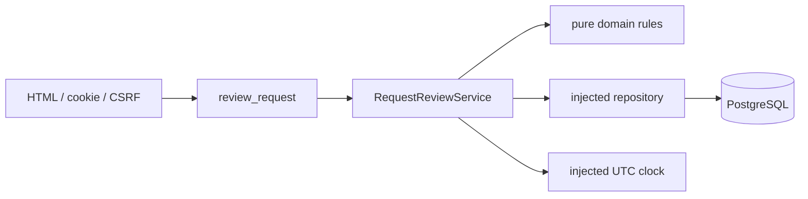

# DESIGN-CAT-01 — طراحی تفصیلی واقعی

ثبت 2026-11-08؛ بازسازی پیاده‌سازی و هدف محدود مرز service؛ بازبینی انسانی باز است.

## D-01 — ورود، نشست و دسترسی

در حالت حافظه‌ای پیمایش نشست‌های منقضی محدود به هر ۳۰ ثانیه زیر بار درج یا چرخش است. انقضای هر توکن در خواندن و چرخش همان لحظه کنترل می‌شود. [ADR-23](../05-architecture/ADRs/ADR-23-memory-session-sweeps.md)

گزینهٔ ساخت حساب در صفحهٔ ورود به فرم `/register` می‌رود. فرم از نشست ناشناس و CSRF استفاده می‌کند. نتیجهٔ موفق یک حساب مشاهده‌گر غیرفعال و رویداد ممیزی در یک تراکنش است. مدیر از بخش کاربران حساب را فعال می‌کند. [ADR-20](../05-architecture/ADRs/ADR-20-account-registration.md)

طرح پیش از کد، 2026-11-17، ADR-18/19: بررسی دوفرمتی PBKDF2 موجود و Argon2id استاندارد، migration فقط پس از موفقیت در executor خصوصی و commit اتمی با audit؛ هیچ کاهش iteration یا cache رمز. آزمایش نشست memory میان workerها و restart قبل از Redis مشترک؛ حالت native حافظه‌ای محفوظ است. store مشترک با token digest، TTL، rotation شرطی، revocation و خطای فارسی 503 بدون fallback؛ دسترسی Redis sync از async در threadpool. proxy round-robin هر درخواست پس از پذیرش آزمایش؛ مرجع فعال‌بودن حساب PostgreSQL است. [مدل جدید](../../models/design/shared-login.mmd) پیش از این تغییرها نوشته شد. انتقال deployment، P95 میلی‌ثانیه‌ای و HA تا شاهد، pending هستند.

main.login فرم را می‌خواند، CSRF را کنترل می‌کند، حساب فعال و PBKDF2 را می‌سنجد، audit را commit و سپس نشست را می‌چرخاند. security.py فقط ساخت token/کوکی/انقضا و CSRF را کنترل می‌کند؛ require_login حساب را از پایگاه دوباره می‌سنجد. access.py نقش و scope را اعمال می‌کند. admin نام کلاس تاریخی جدول است و شامل سه نوع نقش است.

طرح پیش از کد، 2026-11-12، ADR-06: حساب فعال برای هر HTTP request تازه از پایگاه خوانده می‌شود، ولی تکرار require_login در همان request و همان نشست از request.state استفاده می‌کند. انقضا/باطل‌شدن قبل از این استفاده بررسی می‌شود. protected_form و browser_form از run_in_threadpool برای SQL همگام احراز هویت استفاده می‌کنند تا event loop را متوقف نکنند. نشست همچنان process-local است.

طرح پیش از کد ADR-07: راه‌انداز آزمایش چند وب native، proxy async و affinity مرورگر دارد؛ SQL/قواعد/نشست داخل وب‌اند. خرابی وابستگی در proxy با 503 فارسی پاسخ می‌گیرد و POST خودکار تکرار نمی‌شود. استقرار اصلی تا پذیرش بار تک‌پردازه باقی می‌ماند.

طرح پیش از کد، 2026-11-15، ADR-08: transport خروجی proxy از aiohttp ClientSession با DummyCookieJar استفاده می‌کند؛ کوکی مرورگر فقط از درخواست ورودی انتقال می‌یابد و در proxy ذخیره نمی‌شود. redirect و decompression خودکار خاموش‌اند؛ body/query و headerهای متعدد Set-Cookie حفظ، headerهای hop-by-hop و نام‌های Connection حذف و طول body دوباره محاسبه می‌شود. timeout/قطع backend همان 503 و بدون retry نوشتن است. پذیرش ظرفیت همچنان به اندازه‌گیری وابسته است.

در بازبینی 2026-11-17، قرارداد پراکسی مشخص می‌کند که بایت‌های مسیر و query حفظ شوند. برای HEAD و 304 طول معتبر اعلام‌شده توسط وب حفظ می‌شود و 204 بدون هدر طول است. [ADR-21](../05-architecture/ADRs/ADR-21-proxy-http-forwarding.md)

طرح پیش از کد، 2026-11-16، ADR-10: Compose یک وب و یک PostgreSQL جدا با volume تازه دارد. entrypoint container فایل‌های secret جدید را می‌خواند، URL اتصال را فقط در محیط فرایند می‌سازد، seed نمونه را اجرا و یک Uvicorn را exec می‌کند. DB قبل از وب healthy می‌شود؛ health وب اتصال PostgreSQL را هم بررسی می‌کند. پورت میزبان 8001، دادهٔ نمونه مستقل، runtime غیر root و allowlist فایل‌های image؛ .env و HR native وارد image/volume نمی‌شوند.

طرح پیش از کد، 2026-11-17، [ADR-14](../05-architecture/ADRs/ADR-14-downloadable-startup.md): launcher دانلود ZIP، secret initializer موجود را در کانتینر موقت بدون شبکه با دو mount محدود اجرا می‌کند؛ سپس همان DB و یک وب را build و تا healthyشدن منتظر می‌ماند. به Python میزبان نیاز ندارد و رمز/volume موجود را تغییر نمی‌دهد. FR/BR/UC-01 و رفتار HR محفوظ‌اند.

طرح پیش از کد، 2026-11-17، [ADR-17](../05-architecture/ADRs/ADR-17-compose-proxy-connections.md): force-close خروجی proxy فقط در Compose و log نوع خطا بدون دادهٔ درخواست؛ بدون retry. کنترل نهایی حساب، قفل کوتاه FOR UPDATE تا commit audit دارد؛ صف/hash بیرون Session است.

طرح پیش از کد، 2026-11-17، [ADR-16](../05-architecture/ADRs/ADR-16-isolated-password-work.md): خواندن کوتاه snapshot ورود، بستن Session پیش از hash در executor خصوصی bounded، بازاعتبارسنجی CSRF و active/hash در تراکنش audit و سپس rotation؛ صف ورود اتصال DB و thread عمومی را نگه نمی‌دارد. قدرت PBKDF2 محفوظ و صف پر 503 بدون ورود می‌گیرد.

طرح پیش از کد، 2026-11-17، [ADR-15](../05-architecture/ADRs/ADR-15-compose-login-replicas.md): آزمایش چهار وب Compose با proxy موجود، hostnameهای داخلی صریح و affinity مرورگر برای حفظ نشست؛ هر وب thread/pool محدود دارد و seed/fixture فقط در وب اول انجام می‌شود. topology اصلی تا شاهد پذیرش تک‌وب است؛ چهار وب روی همین میزبان، HA یا CPU تازه محسوب نمی‌شود.

## D-02 — تصمیم درخواست

| جزء | مسئولیت و قرارداد |
|---|---|
| modules.review_request | دریافت فرم/CSRF/active admin، normalization و تبدیل ReviewError به HTTP |
| Reviewer | مقدار immutable هویت، نقش و محدوده |
| domain.validate_decision | نقش مجاز، هدف approved/rejected، طول notes و علت رد |
| domain.decision_changes_state | انتقال pending، retry یکسان و conflict نهایی |
| RequestReviewService.review | تزریق repository/clock؛ ترتیب اعتبارسنجی، تراکنش، قفل و ذخیره |
| RequestReviewRepository | SQLAlchemy session، قفل request سپس employee، query overlap، تصمیم و audit |
| ReviewResult | id/kind/changed؛ دادهٔ کافی برای redirect |
| ReviewError | code/message/status_code؛ خطای typed داخلی، نه پاسخ JSON عمومی |

دامنه به HTTP/ORM وابسته نیست. Service زمان UTC را از standard library یا clock تزریق‌شده می‌گیرد و به ORM module وابسته نمی‌ماند. API عمومی و schema داده در این اصلاح تغییر نکرده‌اند.

طرح کلاس editable در [CLS-01](../../models/design/classes.mmd) و طرح component در [CMP-01](../../models/design/components.mmd) است.

## D-03 — فیش آموزشی

calculate_payroll همچنان route با منطق مستقیم است: اعتبارسنجی admin/ماه، قفل employee، بررسی فیش یکتا، profile/rule فعلی، جمع تردد، Decimal و ROUND_HALF_UP، سپس snapshot و audit در همان commit. payslip_detail مقدارها را از snapshot می‌خواند. محاسبهٔ ساعتی regular را از overtime جدا می‌کند تا اضافه‌کاری دوباره در base حساب نشود.

نمونهٔ fixture واقعی آزمون: base=60000000، benefits=5000000، deductions=1000000، 200 ساعت مبنا، 120 دقیقه اضافه‌کاری، ضریب 1.5، بیمه 5٪ و مالیات 10٪، خالص ماهانه 55015000 ریال. این اعداد آموزشیِ fixture هستند، نرخ قانونی نیستند.

## D-04 — سایر حوزه‌ها

داشبورد چهار شمارش هم‌محدوده را در یک دستور SQL می‌خواند. برای مدیر و کارشناس، پنج پروندهٔ اخیر فقط با فیلدهای نمایش واکشی می‌شوند. [ADR-22](../05-architecture/ADRs/ADR-22-dashboard-reads.md)

طرح پیش از اصلاح کد 2026-11-17: [ADR-11](../05-architecture/ADRs/ADR-11-page-reference-reads.md) نام منابع فهرست ماژول را با شناسه‌های همین صفحه و یک projection id/label به ازای هر model می‌خواند. نقشه فقط محلی همان پاسخ است؛ scope/count/page، جزئیات و برچسب‌های موجود حفظ می‌شوند. [مدل خواندن](../../models/design/read-catalog.mmd) قرارداد کم‌کردن SELECTهای وابسته به تعداد سلول‌ها را نشان می‌دهد.

طرح پیش از اصلاح کد 2026-11-17: [ADR-12](../05-architecture/ADRs/ADR-12-projected-csv-reads.md) CSV را با projection همان هشت ستون و cursor با batch 500 می‌سازد؛ پاسخ همچنان buffered و audit پیش از پاسخ commit می‌شود. [ADR-13](../05-architecture/ADRs/ADR-13-canonical-report-period.md) validation، query جمع فیش و context گزارش را به همان دورهٔ normalizeشده وصل می‌کند. [UC-11](../../specs/UC-11.yaml) و [sequence](../../models/sequences/UC-11.mmd) مثبت/منفی/مرز و اثر را ثبت می‌کنند. schema، API، session و استقرار تغییر نمی‌کنند؛ رفتار قبلی بازسازی شده و این سه طرح پیش از اصلاح‌های تازه نوشته شده‌اند.

module_forms.MODULES مشخصات فرم و model را انتخاب می‌کند؛ parse_fields و validate_record قواعد را در modules.py اعمال می‌کنند. این سازوکار بازاستفادهٔ فرم است، سرویس مستقل دامنه نیست. main.py برای employee/organization منطق مستقیم دارد. دادهٔ سازمان فعلی مبنای گزارش دوره است؛ query تاریخیِ effective-dated هنوز وجود ندارد.

طرح پیش از کد، 2026-11-12، CR-02: فهرست کارکنان، ماژول‌ها و فیش‌ها از helper مشترک صفحه‌بندی استفاده می‌کنند. ابتدا نقش/محدوده و فیلتر، سپس count و LIMIT/OFFSET با ترتیب id نزولی اجرا می‌شود. پیش‌فرض 50 و سقف 100 ردیف است؛ ورودی نامعتبر 400، صفحهٔ خارج از انتها به آخر محدود می‌شود و نتیجهٔ خالی صفحهٔ 1 دارد. لینک‌های فارسی قبلی/بعدی فیلتر و اندازهٔ صفحه را نگه می‌دارند. total فقط نتیجهٔ مجاز و فیلترشده است. این helper مرز دامنهٔ جدید نیست و schema تغییر نمی‌کند. گزینه‌های فرم و export خارج از قرارداد صفحه‌بندی فهرست‌اند و محدودیت مستقل دارند.

## الگوها و دلیل انتخاب

طرح پیش از کد، 2026-11-15، ADR-09: save_record به fields_for فرم ارسالی را می‌دهد؛ options_for برای هر source همان scope/eligibility موجود را به همراه `id = submitted_id` اجرا می‌کند. parse_fields همچنان عضویت در گزینهٔ مجاز را می‌سنجد و validate_record کنترل معنایی/FK را انجام می‌دهد. GET و فرم خطا از مسیر گزینه‌های کامل قبلی استفاده می‌کنند. POST معتبر دیگر برای اعتبارسنجی یک employee_id تمام Employeeها را نمی‌خواند.

Repository و Service در تصمیم درخواست، SRP و تزریق وابستگی برای آزمون قواعد و حفظ تراکنش. Enum و state transition برای جلوگیری از تصمیم متناقض. Snapshot برای ثبات فیش؛ DB unique/partial index و row locking برای invariants هم‌زمانی. Generic form configuration برای کاهش تکرار HTML، با هزینهٔ متمرکز شدن اعتبارسنجی‌ها.

Factory/Strategy/Microservices/Outbox/CQRS در این پروژه به‌عنوان پیاده‌سازی ادعا نمی‌شوند. افزودن الگو باید مسئله‌ای را حل کند و شاهد داشته باشد. [API](api-design.md)، [DB](database-design.md)، [spec معماری](../../specs/architecture.yaml) و [traceability](../09-traceability/matrix.md) مرجع تغییرند.
