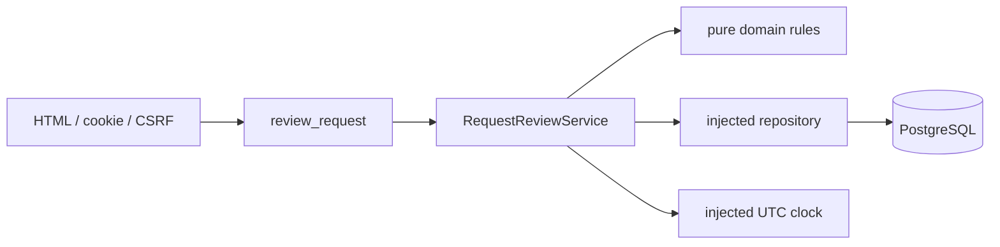

# DESIGN-CAT-01 — طراحی تفصیلی واقعی

ثبت 2026-11-08؛ بازسازی پیاده‌سازی و هدف محدود مرز service؛ بازبینی انسانی باز است.

## D-01 — ورود، نشست و دسترسی

main.login فرم را می‌خواند، CSRF را کنترل می‌کند، حساب فعال و PBKDF2 را می‌سنجد، audit را commit و سپس نشست را می‌چرخاند. security.py فقط ساخت token/کوکی/انقضا و CSRF را کنترل می‌کند؛ require_login حساب را از پایگاه دوباره می‌سنجد. access.py نقش و scope را اعمال می‌کند. admin نام کلاس تاریخی جدول است و شامل سه نوع نقش است.

## D-02 — تصمیم درخواست

| جزء | مسئولیت و قرارداد |
|---|---|
| modules.review_request | دریافت فرم/CSRF/active admin، normalization و تبدیل ReviewError به HTTP |
| Reviewer | مقدار immutable هویت، نقش و محدوده |
| domain.validate_decision | نقش مجاز، هدف approved/rejected، طول notes و علت رد |
| domain.decision_changes_state | انتقال pending، retry یکسان و conflict نهایی |
| RequestReviewService.review | تزریق repository/clock؛ ترتیب اعتبارسنجی، تراکنش، قفل و ذخیره |
| RequestReviewRepository | SQLAlchemy session، قفل request سپس employee، query overlap، تصمیم و audit |
| ReviewResult | id/kind/changed؛ دادهٔ کافی برای redirect |
| ReviewError | code/message/status_code؛ خطای typed داخلی، نه پاسخ JSON عمومی |

دامنه به HTTP/ORM وابسته نیست. Service زمان UTC را از standard library یا clock تزریق‌شده می‌گیرد و به ORM module وابسته نمی‌ماند. API عمومی و schema داده در این اصلاح تغییر نکرده‌اند.

طرح کلاس editable در [CLS-01](../../models/design/classes.mmd) و طرح component در [CMP-01](../../models/design/components.mmd) است.

## D-03 — فیش آموزشی

calculate_payroll همچنان route با منطق مستقیم است: اعتبارسنجی admin/ماه، قفل employee، بررسی فیش یکتا، profile/rule فعلی، جمع تردد، Decimal و ROUND_HALF_UP، سپس snapshot و audit در همان commit. payslip_detail مقدارها را از snapshot می‌خواند. محاسبهٔ ساعتی regular را از overtime جدا می‌کند تا اضافه‌کاری دوباره در base حساب نشود.

نمونهٔ fixture واقعی آزمون: base=60000000، benefits=5000000، deductions=1000000، 200 ساعت مبنا، 120 دقیقه اضافه‌کاری، ضریب 1.5، بیمه 5٪ و مالیات 10٪، خالص ماهانه 55015000 ریال. این اعداد آموزشیِ fixture هستند، نرخ قانونی نیستند.

## D-04 — سایر حوزه‌ها

module_forms.MODULES مشخصات فرم و model را انتخاب می‌کند؛ parse_fields و validate_record قواعد را در modules.py اعمال می‌کنند. این سازوکار بازاستفادهٔ فرم است، سرویس مستقل دامنه نیست. main.py برای employee/organization منطق مستقیم دارد. دادهٔ سازمان فعلی مبنای گزارش دوره است؛ query تاریخیِ effective-dated هنوز وجود ندارد.

## الگوها و دلیل انتخاب

Repository و Service در تصمیم درخواست، SRP و تزریق وابستگی برای آزمون قواعد و حفظ تراکنش. Enum و state transition برای جلوگیری از تصمیم متناقض. Snapshot برای ثبات فیش؛ DB unique/partial index و row locking برای invariants هم‌زمانی. Generic form configuration برای کاهش تکرار HTML، با هزینهٔ متمرکز شدن اعتبارسنجی‌ها.

Factory/Strategy/Microservices/Outbox/CQRS در این پروژه به‌عنوان پیاده‌سازی ادعا نمی‌شوند. افزودن الگو باید مسئله‌ای را حل کند و شاهد داشته باشد. [API](api-design.md)، [DB](database-design.md)، [spec معماری](../../specs/architecture.yaml) و [traceability](../09-traceability/matrix.md) مرجع تغییرند.
