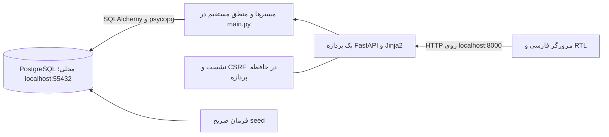

# یادداشت‌های معماری مبنا

## ساختار فعلی

این مرحلهٔ ساخت کاربردی یک وب و یک پایگاه محلی دارد. بسته‌بندی وب و PostgreSQL در یک کانتینر واحد، آزمایش مجزای آینده است و هنوز اجرا نشده است. هیچ فایل Docker، Compose یا Kubernetes تولید نشده است.

## محدودیت‌های واقعی این نسخه

- مسیر HTTP، اعتبارسنجی و عملیات پایگاه داده در `main.py` کنار هم هستند. این انتخاب برای خوانایی مبتدی است و هنوز تفکیک مسئولیت‌ها انجام نشده است.
- فقط یک پردازهٔ وب اجرا می‌شود. اجرای چند worker با این نشست حافظه‌ای پشتیبانی نمی‌شود.
- نشست‌ها در حافظه‌اند. در آزمون واقعی، پس از توقف و راه‌اندازی مجدد وب ورود قبلی معتبر نبود و ورود دوباره لازم شد. این نتیجهٔ طراحی فعلی است؛ دادهٔ کارمند از PostgreSQL دوباره خوانده شد و باقی مانده بود.
- شعبه، واحد، سمت و نوع قرارداد فقط مقدار فعلی‌اند. ویرایش آن‌ها تاریخچهٔ زمانی ایجاد نمی‌کند. این محدودیت از مدل فعلی مشخص است؛ خرابی اندازه‌گیری‌شدهٔ گزارش تاریخی ادعا نشده است.
- کارها هم‌زمان با درخواست انجام می‌شوند؛ صف، پردازش غیرهم‌زمان طولانی و کش وجود ندارد.
- نقش‌ها به یک مدیر محدودند؛ مجوز تفصیلی شعبه و واحد و audit هنوز در محدوده نیست.
- فهرست کارکنان صفحه‌بندی ندارد؛ تاریخ میلادی است؛ بررسی ملی فقط قالب ۱۰ رقم را کنترل می‌کند.
- راه‌اندازی شامل `create_all` برای جدول‌های اولیه است؛ چارچوب مهاجرت‌های نسخه‌دار هنوز ساخته نشده است. یک ارتقای کوچک حین ساخت همین مرحله برای کلیدهای ثابت دادهٔ نمونه انجام شد و داده‌ها حفظ شدند.

## فرضیه‌های آزمایش‌نشده

رشد داده یا کاربران ممکن است هزینهٔ جست‌وجو، رندر فهرست و رقابت منابع را افزایش دهد. وب و پایگاه روی یک رایانه از منابع مشترک استفاده می‌کنند. منطق درهم‌تنیده ممکن است تغییر قواعد آینده را دشوار کند. فعلاً برای این موارد آزمایش بار، CPU، RPS، P95/P99، آزمون کندی پایگاه یا خرابی میزبان انجام نشده است و عددی به عنوان اندازه‌گیری ارائه نمی‌شود.

## شواهد موجود این مرحله

آزمون واقعی HTTP و PostgreSQL، ذخیرهٔ رکورد و حفظ شناسه، اطلاعات و وضعیت آن بعد از راه‌اندازی مجدد وب را تأیید کرد. رد ترکیب نامعتبر شعبه/واحد هم در لایهٔ برنامه و هم با یک درج مستقیم آزمایشی در PostgreSQL تأیید شد. مرورگر ثبت، ویرایش و تغییر وضعیت واقعی را انجام داد. این بررسی‌ها جایگزین آزمایش معماری زیر بار نیستند.

## روش حفظ مدارک برای آزمایش‌های آینده

برای هر آزمایش، نسخهٔ کد، نمودار معماری، تنظیمات و محدودیت منابع، حجم داده، ترکیب خواندن/نوشتن، تعداد کاربران و نرخ افزایش، مدت، مشخصات سخت‌افزار، فرمان‌ها، CSV و log خام، تصاویر، خطاها و تحلیل را ذخیره کنید. نتایج قبل/بعد باید با بار قابل‌مقایسه ثبت شوند؛ عدم بهبود هم یک نتیجهٔ معتبر است.

گزارش Word فارسی آینده باید هر مشکل را به محرک، شاهد مشاهده‌شده، علت، راه‌حل، گزینه‌های جایگزین، آزمون تأیید و محدودیت باقی‌مانده وصل کند. پرامپت، خروجی AI و تغییر واقعی دانشجو را جدا ثبت کنید. فایل‌های این مرحله خروجی عامل کدنویسی‌اند؛ هیچ تغییر دانشجو یا اندازه‌گیری آینده ساخته یا حدس زده نشده است.
